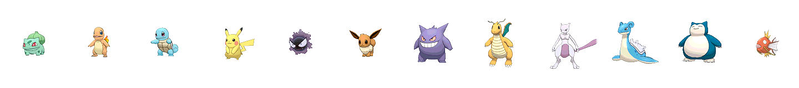

  

# Pokédex visual · Reto 1

**Autores:** 
- Diego José García Callejas · dj.garcia.callejas@alumnos.upm.es
- Héctor Fernández  Cano · hector.fernandez@alumnos.upm.es
  
**Grado:** Grado en Ciencia de Datos e Inteligencia Artificial (UPM)
  
**Asignatura:** Algoritmos y Arquitecturas para Procesado de Imágenes · Curso 2026–2027

**El cuaderno principal se abre aquí:**

  

## Descripción del reto
¿Se puede adivinar el tipo de un Pokémon solo con mirarlo? Este proyecto trata las imágenes como datos visuales para predecir `Type1` y `Type2`, y responde a dos preguntas: **qué tipos son indistinguibles a la vista** y **qué Pokémon es el peor clasificado y por qué**.

## Solución propuesta

## Dataset
Se usan dos versiones del dataset:

| Versión | Descripción | Descarga |
|---|---|---|
| **Original** | Tal como se publica en Kaggle: 809 imágenes PNG de 120×120 y `pokemon.csv` con `Type1` y `Type2`. | [OneDrive (original, ≈5 MB)](https://upm365-my.sharepoint.com/:u:/g/personal/dj_garcia_callejas_alumnos_upm_es/IQAWr1Ia_bp2TZZZH5nPwWHUAUUoHcJxVmKW2VdwjSZWzdI?e=ekSCVa&download=1) |
| **Modificado** | Versión balanceada con aumento de datos: sin la clase Flying y con 200 imágenes por tipo (`Type1`), completadas con transformaciones geométricas y fotométricas suaves (ver detalle más abajo). | [OneDrive (modificado, ≈24 MB)](https://upm365-my.sharepoint.com/:u:/g/personal/dj_garcia_callejas_alumnos_upm_es/IQBe4NOKi-OlRIGvmtjXi74pAVRY8HSWdSN7L0CKZ_5tYuk?e=xOxnfv&download=1) |

**Balanceo de clases.** Se elimina la clase `Flying` de `Type1`, porque solo tiene 3 imágenes (aparece mucho más como `Type2`, pero no se usa como clase principal). Las 17 clases restantes se completan hasta **200 imágenes cada una** aplicando las transformaciones descritas a continuación sobre imágenes originales de esa clase. `Type2` se conserva como etiqueta secundaria.

<b>Transformaciones aplicadas al dataset modificado</b>

| Transformación | Parámetros y aplicación |
|---|---|
| Rotación | Ángulo entre −12° y +12°, con interpolación bicúbica. Se utiliza un lienzo intermedio ampliado para evitar cortar el objeto. |
| Transformación afín | Escala uniforme entre 0,92 y 1,04 y desplazamientos horizontales y verticales de hasta ±3 % del ancho y alto. La escala y la posición finales se limitan si es necesario para mantener el Pokémon completo dentro del lienzo. |
| Recorte del fondo (*crop*) | Se elimina hasta un 4 % por lado, limitado al margen transparente disponible. Se conserva todo el objeto, se redimensiona uniformemente y se centra sobre un lienzo del tamaño original. |
| Brillo | Factor entre 0,92 y 1,08 mediante `ImageEnhance.Brightness`. |
| Saturación | Factor entre 0,95 y 1,05 mediante `ImageEnhance.Color`. |
| Contraste | Factor entre 0,92 y 1,08 mediante `ImageEnhance.Contrast`, calculado sobre los píxeles del objeto, excluyendo el fondo completamente transparente. |
| Gamma | Exponente entre 0,92 y 1,08, aplicando `salida = 255 × (entrada / 255)^gamma` a los canales RGB. |
| Ruido gaussiano suave | Media cero y desviación estándar entre 1 y 2,5, en la escala de intensidad 0–255. Se aplica únicamente a píxeles con alfa mayor que cero. Cada píxel recibe la misma perturbación en R, G y B para evitar motas de colores. |
| Desenfoque gaussiano | Radio entre 0,2 y 0,45 píxeles mediante `ImageFilter.GaussianBlur`. Se trabaja con colores premultiplicados por alfa para evitar bordes oscuros artificiales. |
| Reducción de resolución | Se reduce cada dimensión al 85–95 % de su tamaño y después se recuperan las dimensiones originales mediante interpolación bicúbica. |

**Fuente original:** [Pokemon Image Dataset](https://www.kaggle.com/datasets/vishalsubbiah/pokemon-images-and-types), de Vishal Subbiah, en Kaggle.

**Subconjunto usado (modificado):** 806 imágenes originales + 2.594 aumentadas = 3.400 imágenes (200 por cada uno de los 17 tipos de `Type1`).
## Resultados principales

## Cómo reproducir

## Demo y presentación

## Licencia y créditos
- **Código:** licencia MIT (ver [`LICENSE`](LICENSE)).
- **Dataset original:** *Pokemon Image Dataset*, de Vishal Subbiah, disponible en [Kaggle](https://www.kaggle.com/datasets/vishalsubbiah/pokemon-images-and-types). Licencia [Attribution 4.0 International (CC BY 4.0)](https://creativecommons.org/licenses/by/4.0/).
- **Dataset modificado:** derivado del anterior, por lo que se redistribuye bajo la misma licencia [CC BY 4.0](https://creativecommons.org/licenses/by/4.0/), con atribución al autor original e indicación de los cambios realizados (ver tabla de Dataset).
- Pokémon y sus nombres son marcas de Nintendo, Game Freak y The Pokémon Company. Uso exclusivamente académico.
